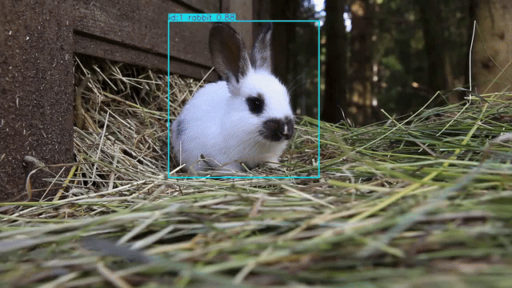
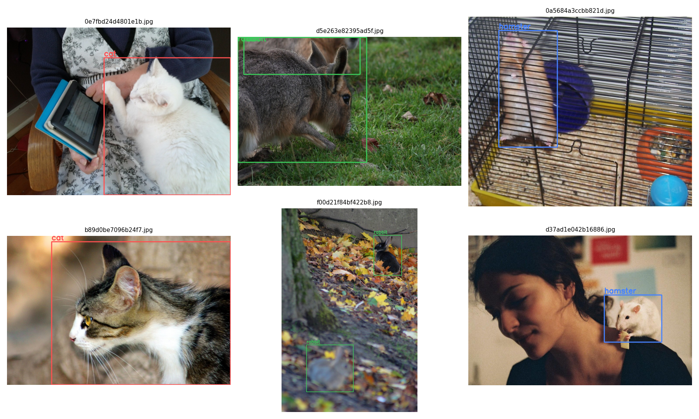
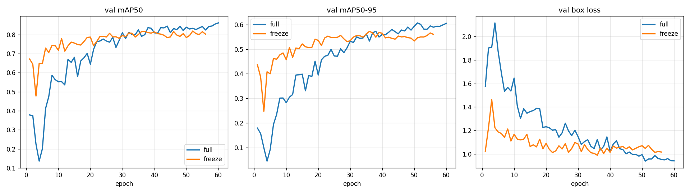
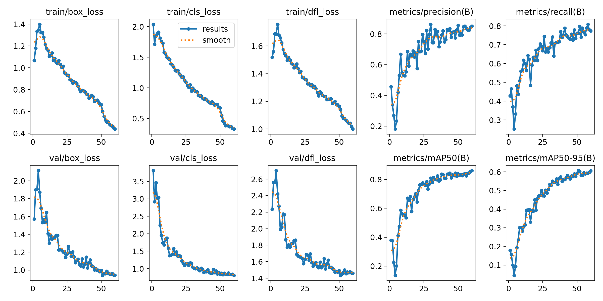
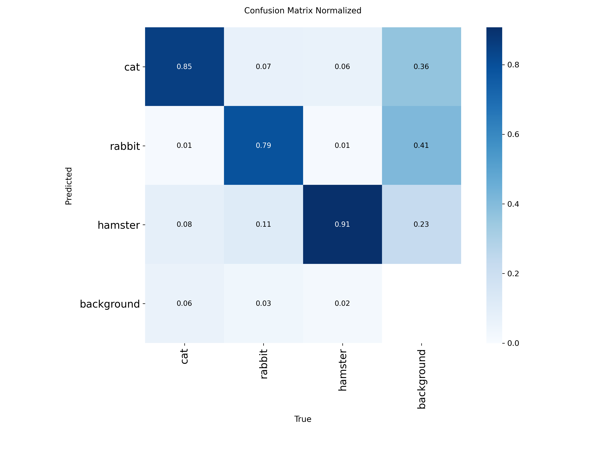
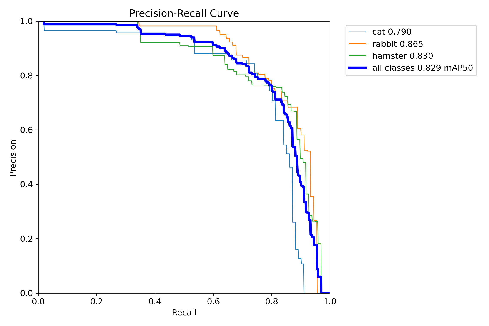
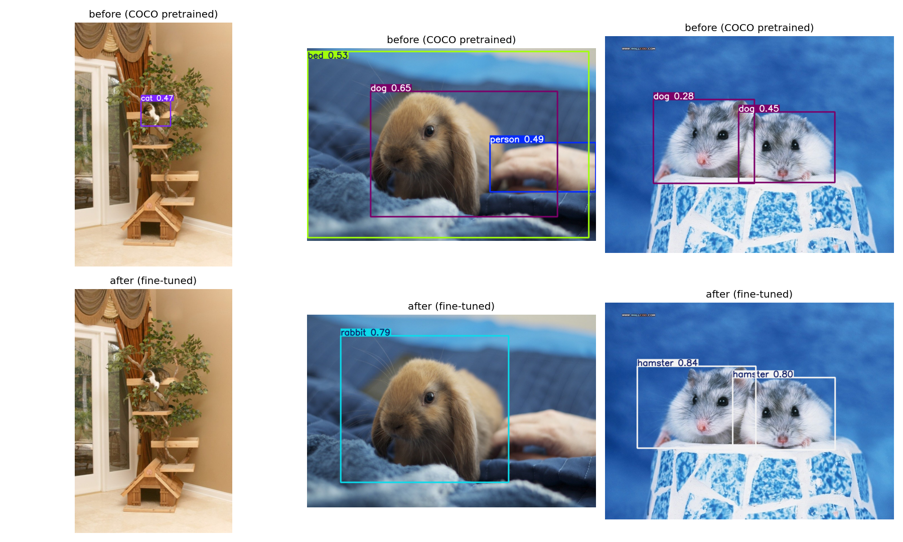

# YOLOv8 fine-tuning: 반려동물 3개 부류 감지·추적

머신러닝 과제 2의 결과 저장소입니다. COCO로 사전학습된 YOLOv8s를 3개 부류(cat, rabbit, hamster)에 fine-tuning하고,
학습된 모델로 영상에서 객체를 감지·추적했습니다.

| 항목 | 내용 |
|---|---|
| 데이터 | Open Images V7에서 부류당 400장, 총 1,200장 (train 840 / valid 240 / test 120) |
| 모델 | `yolov8s.pt`에서 출발한 전체 학습(`full`), 60 epoch |
| 성능 (test) | mAP50 0.752, mAP50-95 0.479 |
| 결과 영상 | BoT-SORT 추적, 5.0초 (1280×720, 30fps) |

## 결과 영상



- 원본 화질 영상: [`videos/result_tracking.mp4`](videos/result_tracking.mp4) (5.0초)
- 상자 위의 숫자는 추적 ID이고, 흰 선은 최근 30프레임 동안의 이동 궤적입니다.
- 추적 알고리즘: `botsort.yaml`, confidence 임계값: 0.35
- 프레임별 추적 기록: [`results/tracks.csv`](results/tracks.csv)
- 영상 원본 출처: 무료 스톡 영상 (Pixabay, Pexels)

## 데이터

- 출처: [Open Images Dataset V7](https://storage.googleapis.com/openimages/web/index.html)의 상자 주석이 있는 이미지
  (주석 CC BY 4.0, 이미지는 CC BY 2.0으로 등록된 사진)
- Open Images의 부류 Cat, Rabbit, Hamster에서 부류마다 최대 400장을 무작위로 골랐습니다 (시드 0).
- 선별 기준: 여러 마리를 한 상자로 묶은 주석과 그림·인형 주석이 있는 이미지(1554장),
  같은 대상에 두 부류의 상자가 겹쳐 붙은 이미지(45장)는 제외하고,
  대상의 상자가 이미지 면적의 2% 이상인 이미지만 사용했습니다.
- 사용한 이미지: 총 1200장 (train 840 / valid 240 / test 120),
  목록은 [`results/image_list.csv`](results/image_list.csv)에 있습니다.

| class | images | boxes | images_train | images_valid | images_test |
|---|---|---|---|---|---|
| cat | 403 | 477 | 282 | 81 | 40 |
| rabbit | 402 | 499 | 282 | 80 | 40 |
| hamster | 400 | 473 | 280 | 80 | 40 |



## 학습 전 모델(COCO 사전학습)의 판정

COCO의 80개 부류에는 cat만 있고 rabbit과 hamster는 없습니다. 아래 표는 시험용 이미지의 정답 상자를
학습 전 모델이 무엇으로 판정했는지의 비율(%)입니다 (confidence 0.25 이상이고 IoU 0.5 이상 겹친 예측 기준, 행의 합 = 100).

| 실제 부류 | cat | dog | bird | bed | bear | 기타 | 감지 없음 |
|---|---|---|---|---|---|---|---|
| cat | 75.9 | 1.7 | 1.7 | 1.7 | 0.0 | 0.0 | 19.0 |
| rabbit | 31.9 | 21.3 | 6.4 | 2.1 | 6.4 | 14.9 | 17.0 |
| hamster | 58.8 | 7.8 | 7.8 | 2.0 | 0.0 | 2.0 | 21.6 |

## 학습

- 사전학습 가중치: `yolov8s.pt` (COCO)
- 설정: epochs 60 (patience 20), imgsz 640, batch 16, seed 0
- 환경: Ultralytics 8.4.216, Tesla T4
- 실험 `full`: 모든 층을 학습
- 실험 `freeze`: 백본(앞 10개 층)을 고정하고 넥과 헤드만 학습

| experiment | epochs_run | best_epoch | val_mAP50 | val_mAP50-95 | train_minutes | gpu_mem_gb |
|---|---|---|---|---|---|---|
| full | 60 | 51 | 0.829 | 0.607 | 16.5 | 4.91 |
| freeze | 56 | 36 | 0.816 | 0.573 | 14.4 | 3.18 |



## 성능 (test 분할)

| experiment | class | P | R | mAP50 | mAP50-95 |
|---|---|---|---|---|---|
| full | all | 0.803 | 0.726 | 0.752 | 0.479 |
| full | cat | 0.702 | 0.621 | 0.633 | 0.323 |
| full | rabbit | 0.867 | 0.830 | 0.860 | 0.685 |
| full | hamster | 0.841 | 0.728 | 0.764 | 0.428 |
| freeze | all | 0.719 | 0.700 | 0.729 | 0.459 |
| freeze | cat | 0.766 | 0.619 | 0.674 | 0.384 |
| freeze | rabbit | 0.603 | 0.872 | 0.818 | 0.633 |
| freeze | hamster | 0.787 | 0.608 | 0.695 | 0.359 |

최종 모델은 검증 mAP50-95가 더 높은 `full` 실험의 가중치이며 [`weights/best.pt`](weights/best.pt)에 있습니다.

아래의 학습 곡선, 혼동 행렬, PR 곡선은 학습 중 검증(valid) 분할로 계산한 것입니다.
혼동 행렬은 검증용 기본값인 confidence 0.001 이상의 예측을 모두 집계한 것이라 `background` 열이 크게 나타납니다.
영상에 사용한 confidence 0.35 조건의 결과가 아니라는 점을 감안해 읽어야 합니다.





## fine-tuning 전후 비교

윗줄은 COCO 사전학습 모델, 아랫줄은 fine-tuning한 모델의 예측입니다.



## 한계

- test 분할이 120장(상자 156개)으로 작아, 부류별 수치의 작은 차이는 신뢰하기 어렵습니다.
- cat은 세 부류 중 test mAP50이 가장 낮습니다(0.633). 위 비교 그림의 첫 열에서도 학습 전에 감지되던 고양이가 학습 후에는 감지되지 않았습니다.
- `full` 학습은 마지막 60 epoch에서도 검증 mAP50이 오르는 중이어서, 더 오래 학습하면 나아질 여지가 있습니다.
- 결과 영상은 구간마다 동물이 한 마리이고 화면 속 위치가 거의 바뀌지 않아, 여러 객체가 엇갈릴 때 추적 ID가 유지되는지는 확인하지 못했습니다.

## 사용 방법

```python
from ultralytics import YOLO

model = YOLO("weights/best.pt")
model.track("my_video.mp4", tracker="botsort.yaml", conf=0.35, save=True)
```

## 파일 구성

- `weights/best.pt`: 학습된 모델
- `videos/`: 감지·추적 결과 영상 (mp4, gif)
- `results/`: 성능 지표, 학습 곡선, 혼동 행렬, 추적 기록, 사용한 이미지 목록
- `data.yaml`: 학습에 사용한 데이터 설정
- `YOLO_pets_assignment2_v2_1.ipynb`: 데이터 수집부터 학습, 평가, 영상 제작까지 전체 과정을 실행한 노트북 (실행 결과 포함)

## 참고

- [Ultralytics YOLO](https://github.com/ultralytics/ultralytics) (AGPL-3.0)
- [Open Images Dataset V7](https://storage.googleapis.com/openimages/web/index.html)
